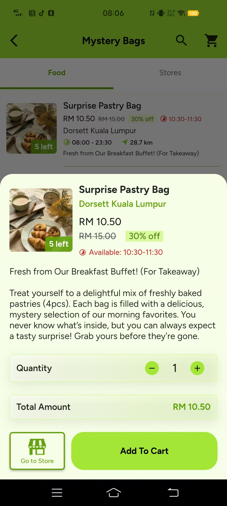
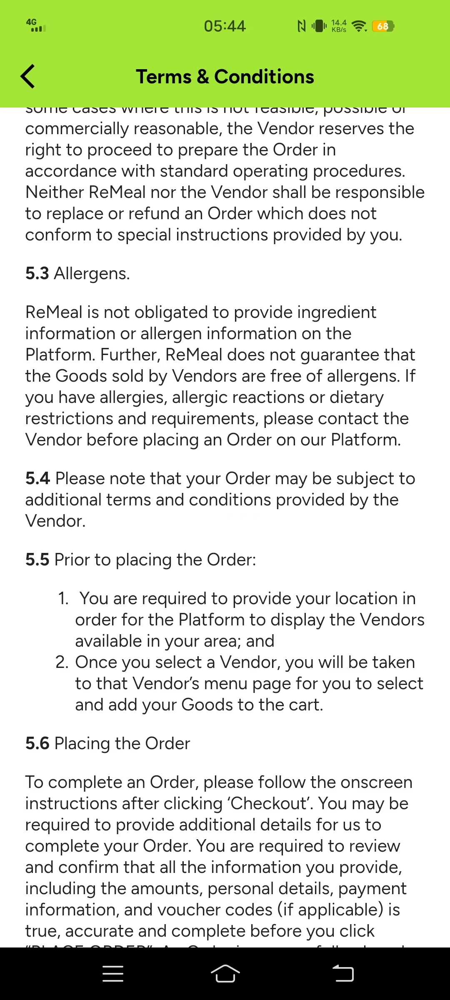
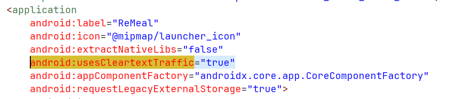
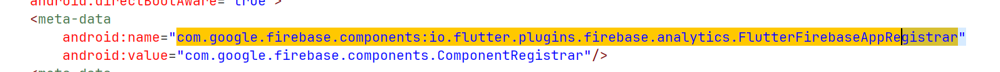
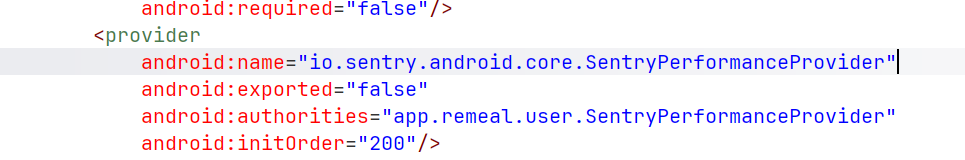
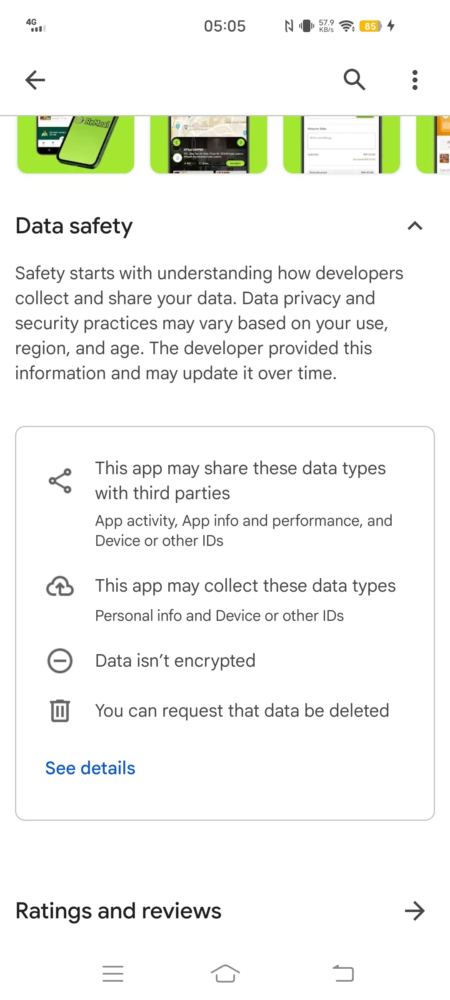
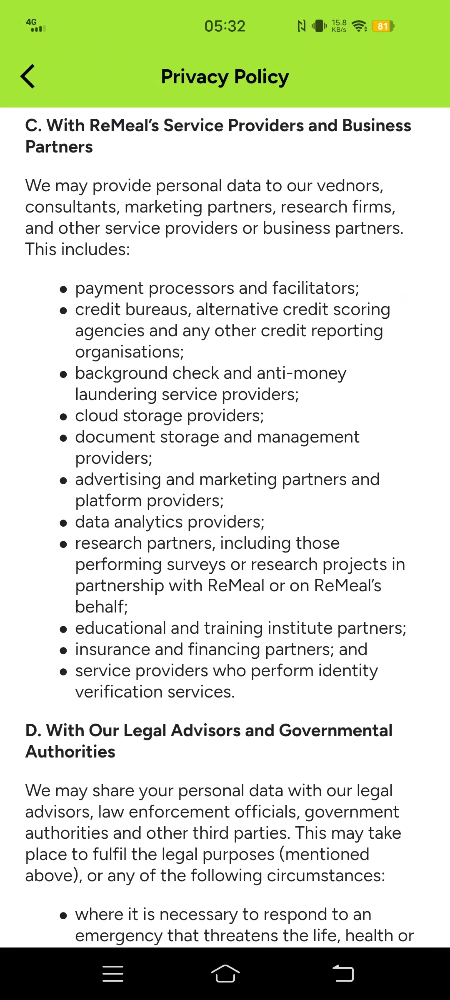

# COMP3041 Professional Ethics — Coursework Part 1 Proposal

**Target Application:** ReMeal (`app.remeal.user`)  
**Convenor:** Dr. Nabil El Ioini  

---

## 1. Selection of Software Application and System Overview

### 1.1 System Identity, Scope, and Hands-On Accessibility
ReMeal (Android package: `app.remeal.user`; Android version 1.1.18) is a mobile application operated by ReMeal Sdn. Bhd., a Malaysian company. It connects food businesses in Kuala Lumpur and Selangor, such as bakeries, cafés, and hotels, with consumers by selling unsold surplus food, packaged as discounted "mystery bags", shortly before closing time. Our group accessed the system hands-on: members installed it from Google Play and the Apple App Store, registered accounts, browsed live store listings, and walked through the ordering flow.

### 1.2 Novelty and Selection Rationale
ReMeal satisfies the coursework selection rules:
1. **Small and local:** It serves two Malaysian regions and is run by a domestic start-up rather than a global platform such as Grab or Foodpanda.
2. **Available and usable:** It is currently available and fully usable by our group, enabling first-hand evidence collection.
3. **Ethically relevant features:** It has visible ethically relevant features, including payment handling, personal-data collection, and the sale of food whose safety cannot be inspected before purchase.
4. **Academically under-examined:** Our preliminary database searches identified no peer-reviewed study of ReMeal itself, so our findings would be original.

Research on comparable surplus-food platforms exists and will inform our literature review, but it cannot substitute for direct investigation of this specific system. These characteristics make ReMeal a niche, locally grounded, and academically under-examined case.

### 1.3 Who Is Affected by ReMeal
The users of ReMeal consist primarily of four groups:
1. **Budget-conscious students and consumers:** Individuals who purchase discounted "Surprise Boxes" before closing time to save on meal costs.
2. **Small bakery and café owners:** Merchants who use the platform to liquidate unsold food inventory at a discount.
3. **Delivery and logistics personnel:** Workers who pick up orders from merchants within specific time windows and deliver them to users.
4. **Software developers and maintenance engineers:** The technical staff responsible for building, deploying, and maintaining the digital marketplace and transaction pipelines.

---

## 2. Preliminary Empirical Investigation & Observed Issues

### 2.1 Testing Method
To collect first-hand evidence, our group downloaded ReMeal and conducted a complete user walkthrough. Starting from phone number registration, we tested the entire flow from browsing stores and adding "Surprise Boxes" to checkout. Additionally, we thoroughly reviewed the app's Terms of Use, Privacy Policy, and the Google Play Data Safety section. Finally, we systematically decompiled the client APK (`jadx-gui`) and analysed real user reviews on the app store to cross-verify the issues identified during hands-on testing.

### 2.2 Issue 1: Missing Allergen and Shelf-Life Information
Developers built the merchant listing flow and consumer interface without mandatory allergen tags or food shelf-life timestamps, and without an allergen display module. Consequently, mystery-bag listings show no allergen or preparation-time information, while Terms Section 5.3 states that ReMeal *"is not obligated to provide ingredient information or allergen information"* and advises consumers to contact the Vendor before ordering (Figures 2.2.1–2.2.2).

<table>
  <tr>
    <td align="center" width="50%">
       
      <b>Figure 2.2.1</b> — Store page showing no allergen or preparation-time information.
    </td>
    <td align="center" width="50%">
       
      <b>Figure 2.2.2</b> — Terms &amp; Conditions Section 5.3 (Allergens): ReMeal "is not obligated to provide ingredient information or allergen information" and advises users to contact the Vendor before ordering.
    </td>
  </tr>
</table>

### 2.3 Issue 2: Cleartext Traffic Permission and Potential Third-Party Data Sharing
Developers set `android:usesCleartextTraffic="true"` in the manifest, permitting unencrypted HTTP rather than enforcing HTTPS/TLS, and integrated Firebase Analytics and Sentry together with the advertising-ID permission (`AD_ID`) (Figures 2.3.1–2.3.4).

Privacy Policy Section 3C states ReMeal *"may provide personal data"* to *"data analytics providers"*, *"advertising and marketing partners"* and *"credit bureaus"*, while Google Play's Data Safety page declares *"Data isn't encrypted"*. At login, the only disclosure observed was a reference to the Privacy Policy; no separate data-sharing consent prompt appeared (Figures 2.3.5–2.3.6).

#### Decompiled `AndroidManifest.xml` evidence (ReMeal v1.1.18, decompiled with jadx-gui)

**Figure 2.3.1** — `android:usesCleartextTraffic="true"` in the `<application>` element, permitting unencrypted HTTP traffic.

**Figure 2.3.2** — Permission declarations, including the advertising-ID permission (`AD_ID`) and `ACCESS_ADSERVICES_*` permissions.

**Figure 2.3.3** — Firebase Analytics component registrar (`FlutterFirebaseAppRegistrar`), indicating integration of Firebase Analytics.

**Figure 2.3.4** — `SentryPerformanceProvider`, indicating integration of the Sentry monitoring library.

#### Public disclosures

<table>
  <tr>
    <td align="center" width="50%">
       
      <b>Figure 2.3.5</b> — Google Play Data Safety page declaring "Data isn't encrypted".
    </td>
    <td align="center" width="50%">
       
      <b>Figure 2.3.6</b> — Privacy Policy Section 3C: ReMeal "may provide personal data" to data analytics providers, advertising and marketing partners, and credit bureaus.
    </td>
  </tr>
</table>

### 2.4 Issue 3: Inaccurate Documentation and Friction in Account Deletion
Regarding the third issue, we observed a direct contradiction between ReMeal's documentation and client implementation. Terms Section 2.2 states that users must send a manual email to request account deletion, and the Play Store lists a web submission route. While the in-app Settings menu contains an account deletion button, its confirmation dialog ambiguously states only that 'You will no longer be able to login,' failing to disclose whether personal data and telemetry profiles are actually erased. 

Furthermore, while the Privacy Policy states users can opt out of targeted ads inside the app, only general push notification toggles exist (enabled by default). This creates conflicting administrative hurdles and deceptive documentation regarding user data erasure.

### 2.5 Issue 4: Prepayment Lock, Lack of Redress, and Asymmetric Liability
Funds are locked immediately after checkout, and the system provides no after-sales or automated refund entry points. Terms clause 6.10 states that ReMeal takes responsibility for refunds only *"strictly if reasonable and justifiable"*, yet the app offers only a generic support chat without order-linked dispute features. 

Furthermore, Terms clause 7.2.2 requires users to inspect and report defects before leaving the vendor premises, even though surprise-bag contents cannot be inspected before collection. By defining itself strictly as an *"agent"* providing matchmaking services (Terms Section 1.1), the platform shifts food quality and spoilage risks entirely onto merchants and consumers.

---

## 3. Thematic Literature Review

### 3.1 Privacy and Surveillance in Comparable Systems
Research on comparable platforms suggests that data collection in food apps is extensive while consent is often weak. Blancaflor et al. (2024) combined policy analysis with a user survey to examine how far Filipino users understood the geolocation consent they gave GrabFood and Foodpanda, finding notable distrust, with 26.7% very concerned that shared data could enable government tracking. Woodcock (2020) shows that surveillance also reaches the workers who deliver the food. His workers’ survey at Deliveroo found riders tracked by GPS and timed at every stage but given only vague performance feedback and no means to dispute deactivations or the data held about them. 

Zhao and Li (2025) take a regulatory angle, simulating stricter European GDPR-style consent rules on a Hong Kong delivery platform. When couriers could opt out of behavioural profiling, more chose to work, raising peak-hour orders served by 25.5% and platform profit by 10.2%. However, their model assumes couriers make informed, freely given choices, an assumption Woodcock’s evidence of information asymmetry calls into question. Together, these studies indicate that consent in food platforms is frequently lacking, and that there exist decisions which benefits users and businesses alike.

### 3.2 Food Safety and Health Risks
Research on food platforms shows that safety information is frequently left to vendor discretion. Auditing 711 menus on iFood, Brazil’s largest delivery app, Vicentini et al. (2026) found ingredient lists were often incomplete and only one menu carried an allergen warning; focus-group participants struggled to identify hidden allergens and called for mandatory allergen fields. Similarly, Nahle, Thaivalappil and Young (2025) found that only 16% of 1,000 Toronto restaurants disclosed allergens online where disclosure was voluntary. 

Mossenson et al. (2024) audited donations to an Australian food bank and found 4% of food by weight was unsafe or unsuitable, largely potentially hazardous items such as meat and ready meals, with over a tonne donated just one day before its use-by date, responsibility over these risks is also often contested. Dai and Wu (2023) modelled platform–restaurant interactions and showed that profit-seeking platforms pass costs onto restaurants, encouraging opportunistic behaviour. They argued that regulators should hold platforms, not only vendors, accountable. Lee, Shin and Ham (2026) found that Korean delivery users who experienced food-related harm were less likely than non-users to complain to the seller and more likely to expect no resolution, and called for accessible redress channels on these platforms.

### 3.3 Relation to ReMeal
These findings map onto ReMeal. Its missing consent screen and obstructed deletion reflect the nominal privacy policies seen elsewhere. Meanwhile, its absent allergen fields, Surprise Boxes with contents hidden until collection, and self-description as an “agent” without dispute channels shift responsibilities onto merchants and consumers, avoiding calls for accountability.

---

## 4. Software Engineering Code & Ethical Framework Analysis

### 4.1 Mapping the Issues to the SE Code
Below, each issue found in ReMeal is mapped to clauses from the ACM/IEEE-CS Software Engineering Code. For each issue, the exact wording of the clause is quoted, along with what the engineers could have done differently. All evidence was collected first-hand on Android in November 2026.

#### Issue 1: Allergen and freshness information
The listings do not have a section for allergens, and Terms clause 5.3 states that ReMeal *"is not obligated to provide ingredient information or allergen information"*. This means the information depends on what each vendor decides to write. For example, a cake listing mentions almonds, but the Gula Cakery Mystery Bag only says its contents depend on *"the day's surplus"*.

This goes against **clause 1.03**, which asks engineers to have *"a well-founded belief it is safe"*, since users with allergies cannot know what they are buying. **Clause 1.04** also requires disclosing *"potential danger to the user"*. Adding a required allergen field, with "may contain" as the default for mystery bags, would solve both.

#### Issue 2: Data transmission and sharing
ReMeal's Play Store page states that data *"isn't transferred over a secure connection"*. The decompiled manifest also sets `usesCleartextTraffic` to `true`, which allows unencrypted HTTP even though Android blocks it by default. On top of this, the Privacy Policy allows sharing with *"credit bureaus, alternative credit scoring agencies"* and advertisers, and the app includes Firebase Analytics and an advertising-ID permission. No consent screen appears in the app.

Turning cleartext traffic back on goes against **clause 3.12**, which asks engineers to *"respect the privacy"* of users. **Clause 3.13** limits data use to *"ways properly authorized"*; however, consent that is only assumed from using the app is weak authorisation for this kind of sharing.

#### Issue 3: Inaccurate documentation and consent by default
ReMeal describes account deletion in three different ways. Terms clause 2.2 says users must send an email, the Play Store says users can submit a request, and the app itself has a button. This button's dialog only says *"You will no longer be able to login"* and does not say whether data is erased. The Privacy Policy also says users can limit targeted ads *"through our ReMeal app"*; however, the app only has two notification toggles, both switched on by default.

**Clause 6.07** states that engineers should *"be accurate in stating the characteristics of software"*, and **clause 1.06** says to *"avoid deception in all statements"*. The software partly meets the Code, since deletion works better than the documents say. However, keeping user-facing descriptions in line with the actual app is still part of the engineer's job.

#### Issue 4: Payment and dispute handling
Terms clause 6.10 states that ReMeal takes responsibility for refunds only *"strictly if reasonable and justifiable"*. The app has a general support chat, but there is no dispute or refund option linked to orders. Terms clause 7.2.2 also requires users to report defects before leaving the vendor, even though mystery-bag contents are unknown until collection.

**Clause 3.01** asks that tradeoffs like this be *"available for consideration by the user"*, yet this one only appears in the Terms. Placing this risk on users also does not align with **clause 1.02**, which asks engineers to *"moderate the interests"* of the employer and the users. The refund policy itself is mostly a business decision outside the engineer's control, which is discussed in Section 4.3.

#### Table 1: Summary of issues mapped to SE Code clauses

| # | Issue | Observable engineering decision | Clauses | Status |
|---|-------|---------------------------------|---------|--------|
| 1 | Allergen and freshness information | No dedicated allergen or ingredient field; information depends on vendor free text | 1.03, 1.04 | Breaks |
| 2 | Data transmission and sharing | Cleartext HTTP enabled in manifest; analytics and ad-ID SDKs; broad sharing; no in-app consent screen | 3.12, 3.13 | Breaks |
| 3 | Inaccurate documentation, consent by default | Three conflicting deletion descriptions; promised ad setting absent; marketing on by default | 6.07, 1.06 | Partly meets |
| 4 | Payment and dispute handling | Refund duty in Terms 6.10 but only generic support chat; inspection burden on user (7.2.2) | 3.01, 1.02 | Partly meets; partly outside engineer control |

### 4.2 Justification of Normative Ethical Theories
To evaluate the engineering choices in ReMeal, we use two complementary ethical theories: Kantian Deontology and Rule Utilitarianism.

Kantian deontology assesses actions based on duty and moral rules rather than end results. Kant's Categorical Imperative states that software engineers must treat users as rational human beings with rights, never merely as tools for company revenue. Building "Roach Motel" account traps or withholding allergen lists directly violates the moral duty of honesty and respect for human autonomy. A policy of deceiving users cannot be turned into a universal rule without destroying public trust in software.

In contrast, Rule Utilitarianism focuses on consequences. It evaluates actions by asking what moral rules produce the greatest overall benefit for society. A software rule that mandates clear allergen warnings and HTTPS data protection produces far more long-term public welfare than an unprincipled rule allowing cost-cutting, which exposes thousands of everyday consumers to food poisoning and data leaks.

### 4.3 Analysis of Code Insufficiency and Value Tension
While the ACM/IEEE-CS Software Engineering Code provides valuable guidelines, it encounters critical limits when applied to real software products.

First, the Code suffers from internal clause tensions. For example, Clause 1.04 requires engineers to disclose any potential dangers to the public, such as food temperature risks or missing allergen labels. However, Clause 2.05 and Clause 2.09 command engineers to protect employer confidentiality and support their employer's business interests. If raising food safety alarms hurts the startup's reputation or reveals merchant problems, these two clauses clash directly. The Code cannot mechanically decide which duty wins.

Second, the Code suffers from the "Wrong Addressee" problem. The Code is written for software engineers, but decisions such as strict "no-refund" terms and legal liability disclaimers are dictated by business owners. When corporate managers demand these features to maintain cash flow, professional guidelines alone cannot force management compliance.

Broader ethical theories resolve these gaps. Under Rule Utilitarianism, preventing physical harm (food poisoning) creates vastly greater social good than protecting a startup's private profits, clearly establishing that public health must override company loyalty.

### 4.4 Plan and Roadmap for Part 2 Completion
In Part 2, our group will build upon this foundation by conducting in-depth technical verification. We will inspect live network traffic using proxy tools to audit actual data transmissions, test user pickup experiences across local bakeries, and formulate concrete redesign recommendations to resolve the ethical and safety issues identified.

---

## 5. Figure Index

| Figure | File | Description |
|---|---|---|
| 2.2.1 | `figure/fig-2.2.1.jpg` | Store page with no allergen or preparation-time information |
| 2.2.2 | `figure/fig-2.2.2.jpg` | Terms Section 5.3 (Allergens) |
| 2.3.1 | `figure/fig-2.3.1.png` | `usesCleartextTraffic="true"` in decompiled AndroidManifest.xml |
| 2.3.2 | `figure/fig-2.3.2.png` | Permission declarations (`AD_ID`, `ACCESS_ADSERVICES_*`) |
| 2.3.3 | `figure/fig-2.3.3.png` | Firebase Analytics component registrar (`FlutterFirebaseAppRegistrar`) |
| 2.3.4 | `figure/fig-2.3.4.png` | Sentry performance monitoring provider declaration |
| 2.3.5 | `figure/fig-2.3.5.jpg` | Google Play Data Safety: "Data isn't encrypted" |
| 2.3.6 | `figure/fig-2.3.6.jpg` | Privacy Policy Section 3C (Third-party data sharing) |

---

## References

Agre, P.E. (1994) ‘Surveillance and capture: Two models of privacy’, *The Information Society*, 10(2), pp. 101–127.

Blancaflor, E., Delfin, I.Z.L., Molate, A., Penafiel, A.I., Villaluz, A. and Balan, A.K. (2024) ‘Ethical use of geolocation data: Privacy concerns in food delivery applications in the Philippines’, in *Proceedings of the 2024 7th International Conference on Information Management and Management Science (IMMS 2024)*. New York: ACM, pp. 346–353. doi:10.1145/3695652.3695683.

Dai, X. and Wu, L. (2023) ‘The impact of capitalist profit-seeking behavior by online food delivery platforms on food safety risks and government regulation strategies’, *Humanities and Social Sciences Communications*, 10, 126. doi:10.1057/s41599-023-01618-w.

Lee, H., Shin, Y. and Ham, S. (2026) ‘Consumer risk perceptions and remedial trust in the food delivery era’, *Discover Food*, 6, 260. doi:10.1007/s44187-026-00987-w.

Mossenson, S., Giglia, R., Pulker, C.E., Chester, M., McStay, C. and Pollard, C.M. (2024) ‘Evidence for initiating food safety policy: An assessment of the quality and safety of donated food at an Australian food bank’, *Food Policy*, 123, 102589.

Nahle, R., Thaivalappil, A. and Young, I. (2025) ‘Food allergy labeling and disclosure practices on restaurants’ online menus in Toronto, Canada’, *Journal of Food Protection*, 88(7), 100533. doi:10.1016/j.jfp.2025.100533.

Vicentini, M.S., Freiria, C.N., Estigarribia, M.N., Cardoso, G.B., Vargas, F.M., Stedefeldt, E., Zanin, L.M., Medeiros, C.O., Ginani, V.C., Rolim, P.M., Rocha, T.E.S., Ferris, I.M., Soon-Sinclair, J.M., Winnall, L.M. and da Cunha, D.T. (2026) ‘Food hypersensitivity communication across physical and online foodservice menus in Brazil: Fragmented regulation and consumer experiences in a mixed-methods study’, *Food Control*, 193, 112628. doi:10.1016/j.foodcont.2026.112628.

Woodcock, J. (2020) ‘The algorithmic panopticon at Deliveroo: Measurement, precarity, and the illusion of control’, *ephemera: theory & politics in organization*, 20(3), pp. 67–95.

Zhao, Z. and Li, S. (2025) ‘The impacts of data privacy regulations on food-delivery platforms’, *Transportation Research Part C: Emerging Technologies*, 181, 105364. doi:10.1016/j.trc.2025.105364.
