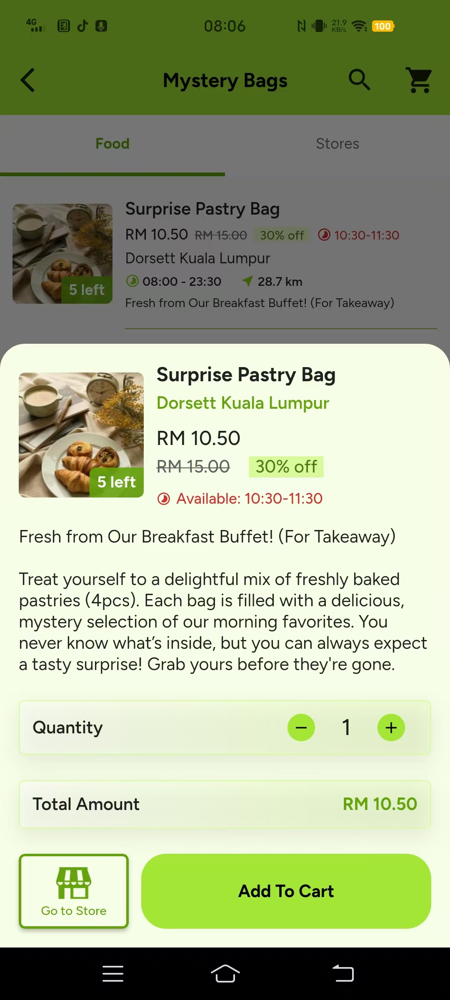
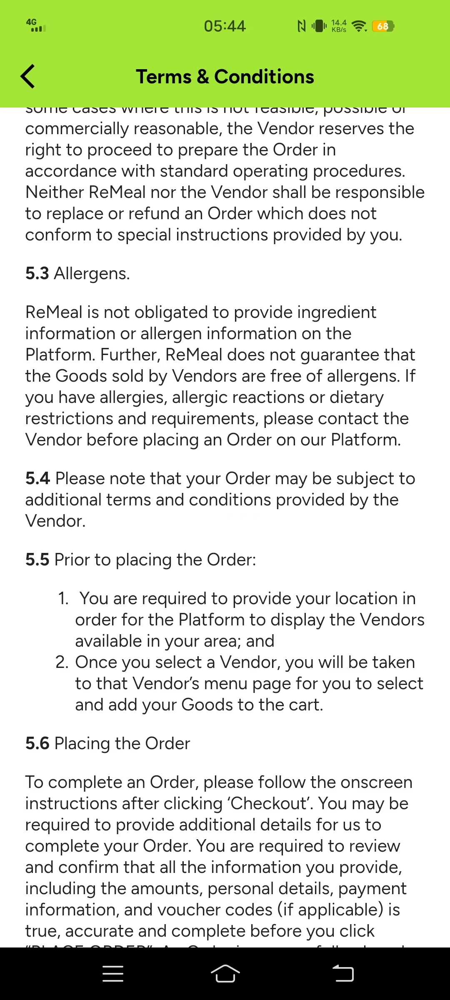
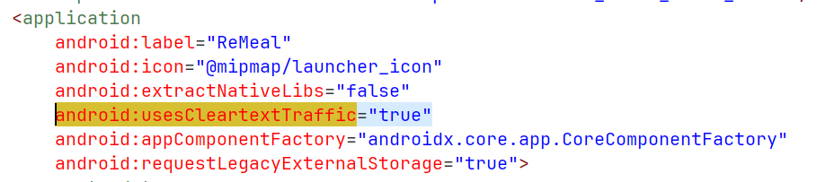
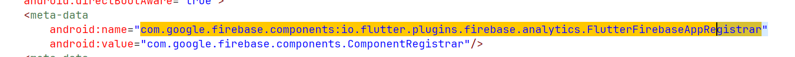
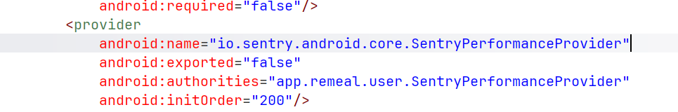
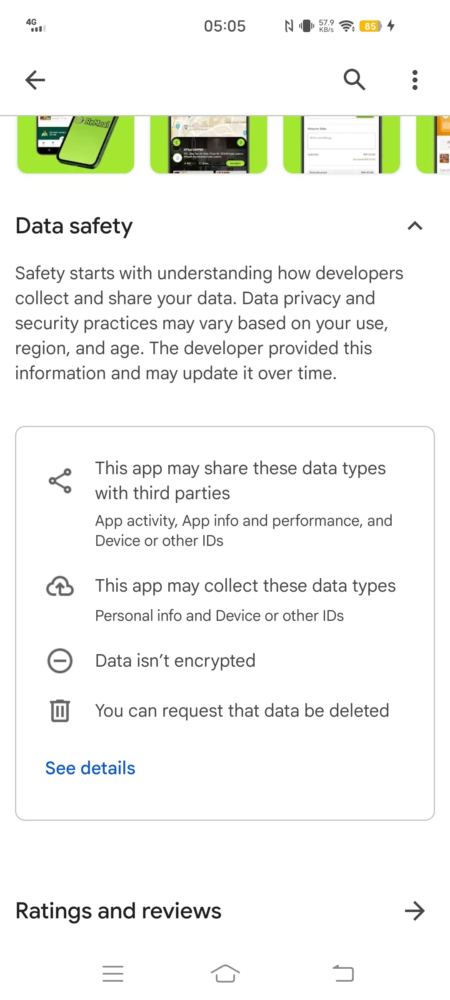
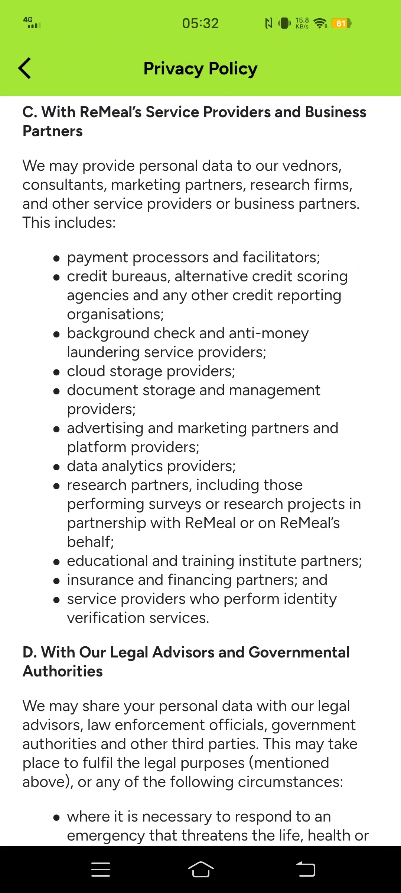

# ReMeal Ethics Case Study — Member 1: Technical & App Overview

**COMP3041 Professional Ethics · Coursework Part 1**
**Target app:** ReMeal (`app.remeal.user`) · **Author:** HUA, KUNMING (Member 1)
**Sections covered:** 1.1, 1.2, 2.2, 2.3

---

## 1.1 System Identity, Scope, and Hands-On Accessibility

ReMeal (Android package: `app.remeal.user`; Android version 1.1.18) is a mobile application operated by ReMeal Sdn. Bhd., a Malaysian company. It connects food businesses in Kuala Lumpur and Selangor, such as bakeries, cafés, and hotels, with consumers by selling unsold surplus food, packaged as discounted "mystery bags", shortly before closing time. Our group accessed the system hands-on: members installed it from Google Play and the Apple App Store, registered accounts, browsed live store listings, and walked through the ordering flow.

## 1.2 Novelty and Selection Rationale

ReMeal satisfies the coursework selection rules.

1. **Small and local:** it serves two Malaysian regions and is run by a domestic start-up rather than a global platform such as Grab or Foodpanda.
2. **Available and usable:** it is currently available and fully usable by our group, enabling first-hand evidence collection.
3. **Ethically relevant features:** it has visible ethically relevant features, including payment handling, personal-data collection, and the sale of food whose safety cannot be inspected before purchase.
4. **Academically under-examined:** our preliminary database searches identified no peer-reviewed study of ReMeal itself, so our findings would be original.

Research on comparable surplus-food platforms exists and will inform our literature review, but it cannot substitute for direct investigation of this specific system. These characteristics make ReMeal a niche, locally grounded, and academically under-examined case.

---

## 2.2 Issue 1: Missing Allergen and Shelf-Life Information

Developers built the merchant listing flow and consumer interface without mandatory allergen tags or food shelf-life timestamps, and without an allergen display module. Consequently, mystery-bag listings show no allergen or preparation-time information, while Terms Section 5.3 states that ReMeal "is not obligated to provide ingredient information or allergen information" and advises consumers to contact the Vendor before ordering. (See Figures 2.2.1–2.2.2)

<table>
  <tr>
    <td align="center" width="50%">
       
      <b>Figure 2.2.1</b> — Store page showing no allergen or preparation-time information.
    </td>
    <td align="center" width="50%">
       
      <b>Figure 2.2.2</b> — Terms &amp; Conditions Section 5.3 (Allergens): ReMeal "is not obligated to provide ingredient information or allergen information" and advises users to contact the Vendor before ordering.
    </td>
  </tr>
</table>

---

## 2.3 Issue 2: Cleartext Traffic Permission and Potential Third-Party Data Sharing

Developers set `android:usesCleartextTraffic="true"` in the manifest, permitting unencrypted HTTP rather than enforcing HTTPS/TLS, and integrated Firebase Analytics and Sentry together with the advertising-ID permission (`AD_ID`). (See Figures 2.3.1–2.3.4)

Privacy Policy Section 3C states ReMeal "may provide personal data" to "data analytics providers", "advertising and marketing partners" and "credit bureaus", and Google Play's Data Safety page declares "Data isn't encrypted". At login, the only disclosure observed was a reference to the Privacy Policy; no separate data-sharing consent prompt appeared. (See Figures 2.3.5–2.3.6)

### Decompiled `AndroidManifest.xml` evidence (ReMeal v1.1.18, decompiled with jadx-gui)

**Figure 2.3.1** — `android:usesCleartextTraffic="true"` in the `<application>` element, permitting unencrypted HTTP traffic.

**Figure 2.3.2** — Permission declarations, including the advertising-ID permission (`AD_ID`) and `ACCESS_ADSERVICES_*` permissions.

**Figure 2.3.3** — Firebase Analytics component registrar (`FlutterFirebaseAppRegistrar`), indicating integration of Firebase Analytics.

**Figure 2.3.4** — `SentryPerformanceProvider`, indicating integration of the Sentry monitoring library.

### Public disclosures

<table>
  <tr>
    <td align="center" width="50%">
       
      <b>Figure 2.3.5</b> — Google Play Data Safety page declaring "Data isn't encrypted".
    </td>
    <td align="center" width="50%">
       
      <b>Figure 2.3.6</b> — Privacy Policy Section 3C: ReMeal "may provide personal data" to data analytics providers, advertising and marketing partners, and credit bureaus.
    </td>
  </tr>
</table>

---

## Figure Index

| Figure | File | Description |
|---|---|---|
| 2.2.1 | `figure/fig-2.2.1.jpg` | Store page with no allergen or preparation-time information |
| 2.2.2 | `figure/fig-2.2.2.jpg` | Terms Section 5.3 (Allergens) |
| 2.3.1 | `figure/fig-2.3.1.png` | `usesCleartextTraffic="true"` |
| 2.3.2 | `figure/fig-2.3.2.png` | Permission declarations (`AD_ID`, etc.) |
| 2.3.3 | `figure/fig-2.3.3.png` | Firebase Analytics |
| 2.3.4 | `figure/fig-2.3.4.png` | `SentryPerformanceProvider` |
| 2.3.5 | `figure/fig-2.3.5.jpg` | Google Play Data Safety: "Data isn't encrypted" |
| 2.3.6 | `figure/fig-2.3.6.jpg` | Privacy Policy Section 3C |
